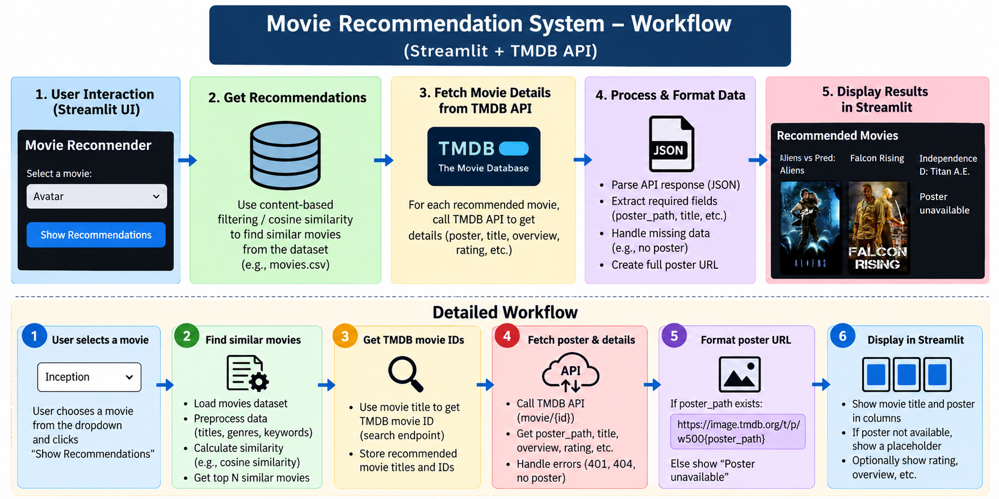

Step 1:- Download and extract zip files

Step 2:- First Open backend folder and open jupyter notebook and run all code in movie-recommender-system.ipynb

Step 3:- Make sure 2 datasets should be same folder

step 4:- After running movie-recommender-system.ipynb you would automatically create 2 .pkl files

step 5:- copy the 2 .pkl files in the main folder

step 6:- In main folder open app.py file

Step 7:- Before running add TMDB_API_KEY in app.py(see below instructions for api key generation)

Step 8:- After entering api key run the program

Step 9:- open terminal and type stremlir run app.py

Step 10:- Your project will open in localhost of streamlit

Step 11:- Finish

WORKFLOW:

TMDB API Key Generation Process:-

Open the official TMDB website: https://www.themoviedb.org/

Create a new account or log in to your existing account.

Go to your profile icon and open Settings.

Select the API option from the settings menu.

Click the option to request or generate an API key.

Select the developer option for your project and fill in the required application details, including your project name, website (if applicable), and project description.

Accept the terms and conditions and submit the application.

After approval, open the API settings page and copy your API Key (v3 auth).

Add the API key to your Python project.

Use the API key in your Python code to fetch movie details, titles, ratings, and poster paths from TMDB.

Test the API request. A status code of 200 indicates a successful request, while a 401 error usually indicates an authentication problem.

Official API documentation: https://developer.themoviedb.org/docs/getting-started